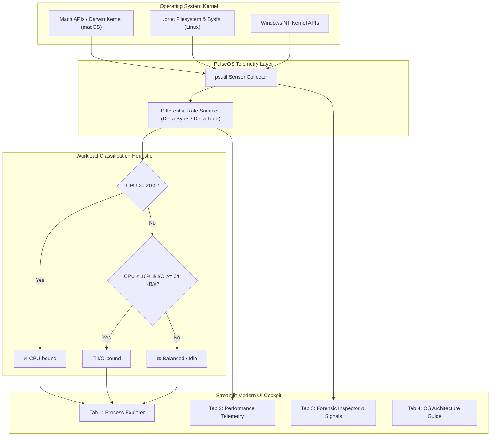

<div align="center">

# ⚡ PulseOS — Process Cockpit & Telemetry Monitor

**A modern, human-crafted operating system process manager and kernel telemetry dashboard built with Python, Streamlit, psutil, pandas, and Plotly.**

[](https://www.python.org/)
[](https://streamlit.io/)
[](https://github.com/)
[](https://opensource.org/licenses/MIT)
[](https://github.com/)

[Overview](#-overview) • [How to Run (All Platforms)](#-how-to-run-step-by-step-guide) • [Key Features](#-key-features) • [Architecture](#-architecture--data-flow) • [Classification Model](#-workload-classification-heuristic) • [Troubleshooting](#-troubleshooting--faqs)

</div>

---

## 📖 Overview

**PulseOS** is an interactive, browser-based operating system monitor and process diagnostics cockpit. It bridges low-level kernel counters with a clean, responsive, human-crafted web dashboard.

Whether you are debugging high CPU spikes, inspecting thread counts and memory maps, analyzing per-core processor load, or categorizing workloads into **CPU-bound** and **I/O-bound** behaviors, PulseOS gives you real-time visibility with zero fluff.

---

## 🚀 How to Run (Step-by-Step Guide)

### 📌 Prerequisites
Make sure you have **Python 3.10 or newer** installed on your system:
- **Download Python:** [python.org/downloads](https://www.python.org/downloads/)
- *(On Windows, make sure to check the box **"Add Python to PATH"** during installation!)*

---

### 1️⃣ Clone the Repository
Open your terminal (macOS/Linux) or Command Prompt (Windows) and clone the project:

```bash
git clone https://github.com/your-username/pulseos-process-cockpit.git
cd pulseos-process-cockpit
```

---

### 2️⃣ Run on macOS

#### Option A: One-Click Script (Recommended)
Simply run the included shell launcher:
```bash
chmod +x run.sh
./run.sh
```
*(This automatically checks for a virtual environment, creates `.venv` if missing, installs dependencies, and launches the app!)*

#### Option B: Manual Terminal Execution
```bash
# 1. Create a virtual environment
python3 -m venv .venv

# 2. Activate the virtual environment
source .venv/bin/activate

# 3. Install required packages
pip install -r requirements.txt

# 4. Launch the Streamlit dashboard
streamlit run app.py
```

#### Option C: In VS Code (Press F5)
1. Open the project folder in **VS Code**.
2. Press **`F5`** (or go to **Run & Debug** on the sidebar and click **Play**).
3. VS Code will launch the dashboard using the configured `.vscode/launch.json`.

---

### 3️⃣ Run on Windows

#### Option A: One-Click Batch File (Recommended)
In File Explorer, simply **double-click `run.bat`**!
*(It will automatically create `.venv`, install packages from `requirements.txt`, and open the dashboard in your default browser).*

#### Option B: Command Prompt (`cmd.exe`)
```cmd
:: 1. Create virtual environment
python -m venv .venv

:: 2. Activate virtual environment
call .venv\Scripts\activate.bat

:: 3. Install dependencies
pip install -r requirements.txt

:: 4. Start dashboard
streamlit run app.py
```

#### Option C: PowerShell
```powershell
# 1. If scripts are disabled, allow local scripts for this session:
Set-ExecutionPolicy -Scope Process -ExecutionPolicy Bypass

# 2. Create and activate virtual environment
python -m venv .venv
.venv\Scripts\Activate.ps1

# 3. Install dependencies
pip install -r requirements.txt

# 4. Launch dashboard
streamlit run app.py
```

---

### 4️⃣ Run on Linux (Ubuntu, Debian, Fedora, Arch)

```bash
# On Ubuntu/Debian, ensure python3-venv is installed:
sudo apt update && sudo apt install python3-venv python3-pip -y

# Make run.sh executable and run it:
chmod +x run.sh
./run.sh
```

**Or manual setup:**
```bash
python3 -m venv .venv
source .venv/bin/activate
pip install -r requirements.txt
streamlit run app.py
```

---

### 5️⃣ Accessing the Dashboard

Once started, Streamlit will display local and network URLs in your terminal:

```
  You can now view your Streamlit app in your browser.

  Local URL:   http://localhost:8501
  Network URL: http://192.168.1.x:8501
```

- **Local:** Open [http://localhost:8501](http://localhost:8501) in your browser.
- **On Mobile or Another Laptop:** Open the `Network URL` on any device connected to the same Wi-Fi network!

---

### 6️⃣ How to Stop the Dashboard
In the terminal window where the app is running, press:
```
Control + C   (macOS / Linux)
Ctrl + C      (Windows)
```

---

### 7️⃣ Running the CLI Terminal Version
If you prefer a terminal-based process viewer (like `htop` or `top`), run the companion CLI monitor:

```bash
# With .venv activated:
python process_manager.py
```

---

## ✨ Key Features

### 🖥️ Tab 1: Interactive Process Explorer
- **Live Task Enumeration:** PID, Name, User, Process Kind (`User`, `System`, `Service`), and Lifecycle Status (`running`, `sleeping`, `idle`, `zombie`).
- **Resource Indicators:** Real-time CPU % progress bars, Resident Set Size (RSS memory in MB and % of total RAM), thread counts, and differential disk read/write throughput.
- **Instant Filter Preset Pills:**
  - `All Processes` · `User Apps` · `System Services` · `High CPU (>10%)` · `High RAM (>250MB)` · `🔥 CPU-bound` · `💾 I/O-bound`
- **Instant Keyword Search:** Real-time search across Process Names, PIDs, and User accounts.
- **Top 5 Consumers Glance:** Visual leaderboard displaying top CPU and memory consumers side-by-side with colored progress bars.
- **Interactive Row Selection:** Click any row in the table to instantly target and inspect the process.
- **CSV Data Export:** Export the filtered table to a timestamped CSV file (`pulseos_processes_YYYYMMDD_HHMMSS.csv`).

### 📈 Tab 2: System Telemetry & Performance
- **Real-Time Utilization Trend:** Dual-axis smoothed spline area chart tracking system CPU % and RAM % across the last 60 sampling cycles.
- **Per-Core CPU Heatmap:** Visualizes every logical core independently with dynamic color thresholds (Emerald `<50%`, Amber `50–80%`, Rose `>80%`).
- **Workload Classification Donut:** Proportional breakdown of CPU-bound, I/O-bound, and balanced tasks.
- **Storage & Network Throughput:** Live differential throughput cards for Disk Read/Write (KB/s) and Network Ingress/Egress (KB/s).

### 🔍 Tab 3: Deep-Dive Process Forensic Inspector & Signals
- **Complete Execution Context:** Parent Process ID (PPID) & Parent Name, Executable Path, Current Working Directory (CWD), and full command-line arguments.
- **Resource Footprint:** User CPU Time, Kernel System Time, Resident Set Size (RSS), Virtual Memory (VMS), % of physical RAM, active threads, open file descriptors, and scheduler Nice priority.
- **POSIX Signal Dispatcher with Safety Guards:**
  - `SIGTERM`: Request clean, graceful shutdown.
  - `SIGKILL`: Immediate force termination.
  - **Kernel Guard:** Protected against terminating PID 0 (kernel), PID 1 (`init`/`launchd`), or the running Streamlit dashboard.
  - **Confirmation Dialog:** Native modal requiring deliberate checkbox acknowledgment before issuing signals.

### 📘 Tab 4: OS Architecture & Methodology Guide
- In-depth documentation covering Unix/Darwin process state transitions, physical RAM (RSS) vs. Virtual Memory (VMS), page replacement, I/O accounting, and OS security boundaries.

### ⚙️ Engine Controls & Live Freeze Mode
- **Live Stream vs. Paused Mode:** Toggle between continuous real-time updates and stationary freeze mode to inspect processes without table jumping.
- **Customizable Sampling Intervals:** Choose between `1s`, `2s`, `5s`, `10s`, or `30s`.
- **Interactive Heuristic Tuning:** Adjust CPU-bound and I/O-bound threshold sliders in real time.

---

## 🏗️ Architecture & Data Flow



---

## 🔬 Workload Classification Heuristic

Kernel hardware counters are monotonically increasing registers. PulseOS samples state differentials across discrete sampling epochs ($t_0$ to $t_1$):

$$\Delta \text{Rate} = \frac{\text{Bytes}_{t_1} - \text{Bytes}_{t_0}}{t_1 - t_0}$$

### Decision Function
$$\text{Workload}(P) = \begin{cases}
\text{CPU-bound}, & \text{if } \text{CPU}(P) \ge 20\% \\
\text{I/O-bound}, & \text{if } \text{CPU}(P) < 10\% \text{ and } (\text{ReadRate} + \text{WriteRate}) \ge 64\text{ KiB/s} \\
\text{Balanced / Idle}, & \text{otherwise}
\end{cases}$$

> **Note on OS Security Boundaries:**
> On macOS (Darwin), unprivileged user-space applications cannot read arbitrary per-process I/O counters due to Mach security barriers and System Integrity Protection (SIP). When process-level I/O counters are restricted, PulseOS handles the access restriction gracefully and displays real-time system-wide block storage throughput via kernel counters.

---

## 📁 Project Structure

```
pulseos-process-cockpit/
├── app.py                      # Main PulseOS Streamlit web dashboard
├── process_manager.py          # Terminal CLI process monitor
├── requirements.txt            # Python dependencies (psutil, streamlit, plotly, etc.)
├── run.sh                      # 1-click launcher for macOS & Linux
├── run.bat                     # 1-click launcher for Windows
├── README.md                   # Comprehensive GitHub documentation
├── PROJECT_REPORT_DRAFT.md     # In-depth technical OS project report
└── .vscode/                    # VS Code launch & settings configurations
    ├── launch.json             # Press F5 to launch Streamlit
    └── settings.json           # Automatic .venv interpreter selection
```

---

## ❓ Troubleshooting & FAQs

#### Q1: `zsh: command not found: python` (macOS)
- **Fix:** On macOS, the default system binary is `python3`. Activate your virtual environment first (`source .venv/bin/activate`), which maps `python` to `.venv/bin/python`, or run `./run.sh`.

#### Q2: `Port 8501 is already in use`
- **Fix:** Streamlit will automatically try port 8502, or you can specify a port explicitly:
  ```bash
  streamlit run app.py --server.port=8505
  ```

#### Q3: Windows PowerShell says `running scripts is disabled on this system`
- **Fix:** Run this command in PowerShell to temporarily allow local script execution:
  ```powershell
  Set-ExecutionPolicy -Scope Process -ExecutionPolicy Bypass
  ```

#### Q4: Why do some processes say `Access Denied`?
- **Answer:** Certain system and kernel processes run as `root`/`SYSTEM` or are protected by OS integrity policies (e.g. macOS SIP). PulseOS respects operating system boundaries and flags restricted fields gracefully rather than crashing.

---

## 🤝 Contributing

Contributions, bug reports, and suggestions are welcome!
1. Fork the Project
2. Create your Feature Branch (`git checkout -b feature/AmazingFeature`)
3. Commit your Changes (`git commit -m 'Add some AmazingFeature'`)
4. Push to the Branch (`git push origin feature/AmazingFeature`)
5. Open a Pull Request

---

## 📄 License

Distributed under the **MIT License**. See `LICENSE` for details.
